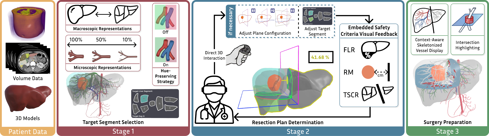
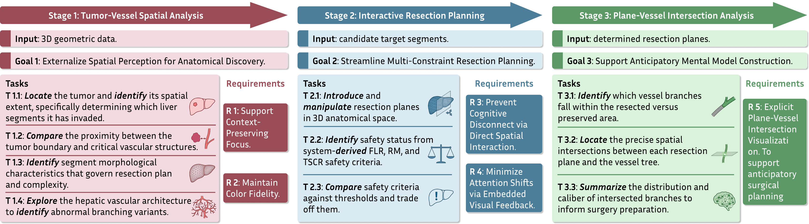
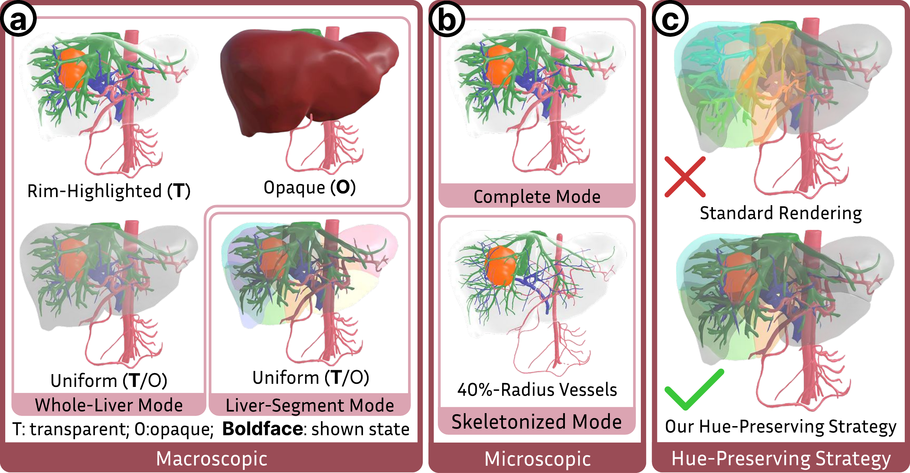
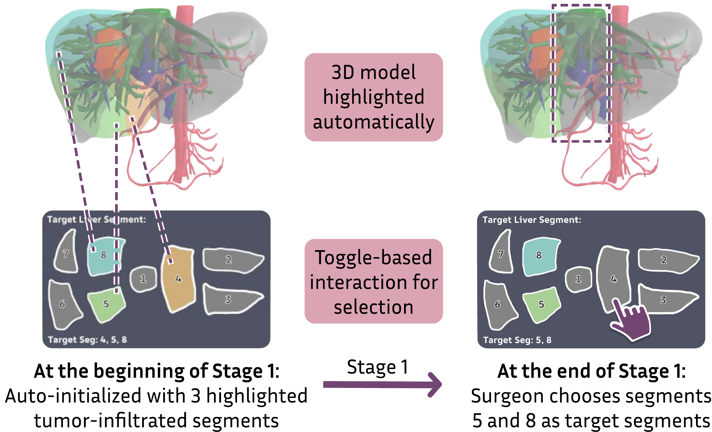
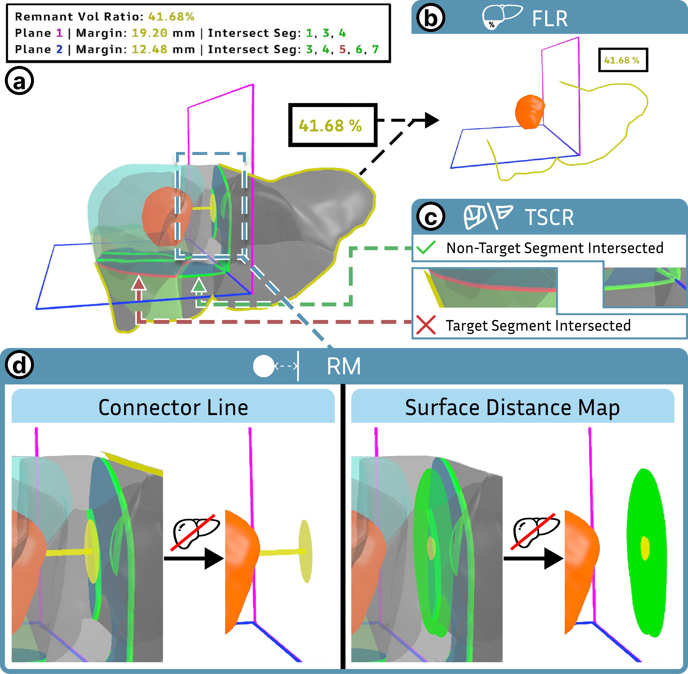
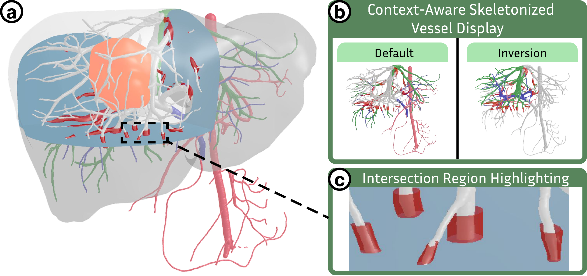
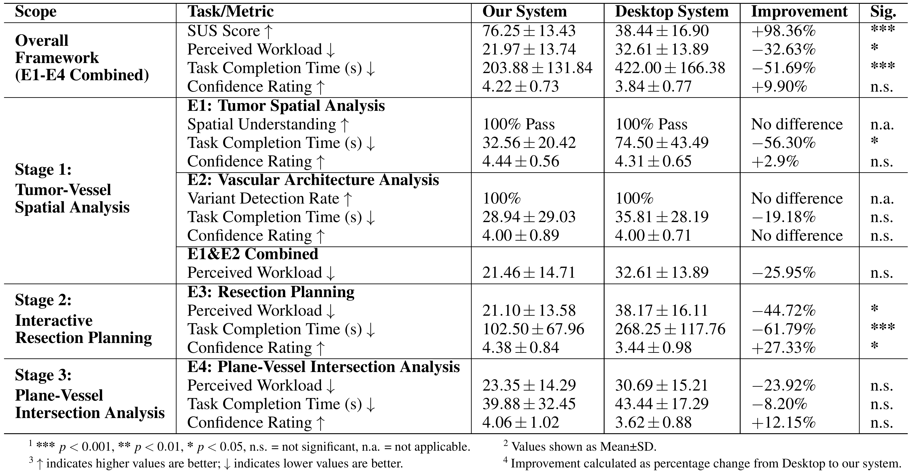
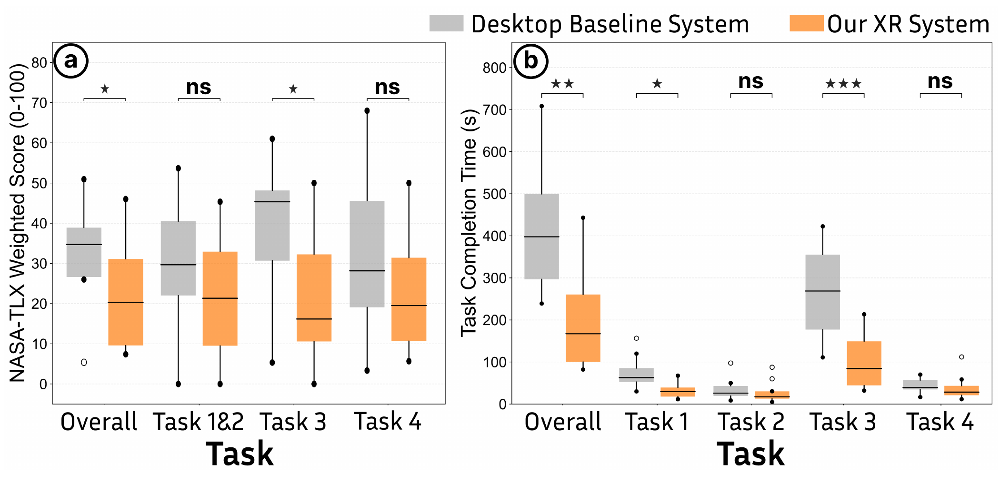

<h1 align="center">LiverPlan: A Stage-Adaptive Immersive Visual Analytics Framework for Anatomical Liver Surgical Planning</h1>

<p align="center">
  <strong>IEEE VIS 2026 (To appear in IEEE Transactions on Visualization and Computer Graphics)</strong>
</p>

<h4 align="center">
  Qixuan Liu<sup>1</sup>, Shi Qiu<sup>1</sup>, Xiwen Wu<sup>2</sup>,
  Yuqi Tong<sup>1</sup>, Yinqiao Wang<sup>1</sup>, Ruiyang Li<sup>1</sup>,<br>
  Jialun Pei<sup>1</sup>, Shengdong Zhao<sup>3</sup>, Chi-Wing Fu<sup>1</sup>,
  Pheng-Ann Heng<sup>1</sup>
</h4>

<p align="center">
  <sup>1</sup>Institute of Medical Intelligence and XR (IMIXR), The Chinese University of Hong Kong<br>
  <sup>2</sup>Zhujiang Hospital, Southern Medical University<br>
  <sup>3</sup>City University of Hong Kong
</p>

<p align="center">
  <a href="https://arxiv.org/abs/2608.04707"><strong>Paper (arXiv)</strong></a>
  &nbsp; | &nbsp;
  <a href="https://qixuan-luke.github.io/LiverPlan/"><strong>Project Page</strong></a>
  &nbsp; | &nbsp;
  <a href="https://osf.io/k8v3n/overview?view_only=3249373f8f974d6196b687b136ac8f2e"><strong>Demo Video &amp; Supplementary Material</strong></a>
</p>

<p align="center">
  
</p>

**LiverPlan is a stage-adaptive immersive visual analytics framework for anatomical liver resection planning, with visualization and interaction tailored to the cognitive demands of each planning stage.** Surgeons explore and refine the plan in an immersive 3D workspace using a standalone extended reality headset.

## Key Features

- **A cognitively grounded, stage-adaptive visual analytics workflow.** Derived from eight months of collaboration with hepatobiliary surgeons, the workflow aligns visualization and interaction with the distinct cognitive demands of anatomical discovery, multi-constraint resection planning, and surgery preparation.
- **Enhanced visualization of tumor-vessel spatial relationships.** Complementary whole-liver, liver-segment, and adjustable vessel views help surgeons inspect deep tumor-vessel relationships while preserving anatomical context. Hue-preserving rendering maintains diagnostic colors, supporting anatomical discovery and target segment selection.
- **Real-time, embedded visual feedback on critical safety criteria.** Functional Liver Remnant, Resection Margin, and Target Segment Complete Removal are visualized within the focused 3D view to minimize attention shifts and support multi-constraint reasoning during plan refinement.
- **Enhanced spatial understanding of the resection plan.** Focus+Context plane-vessel intersection visualization shows which portions of the vasculature are resected or preserved, where resection planes intersect vessels, and the caliber of the intersected branches. This helps surgeons understand the plan's anatomical implications and build an anticipatory mental model for surgery preparation.

## Design Study

LiverPlan was developed through **eight months of collaboration with two hepatobiliary surgeons**: an attending surgeon with 18 years of experience and a resident surgeon with five years of experience.

- **Clinical Discovery (12 weeks).** Interviews, surgical planning seminars, and observation of a live liver resection surgery helped characterize clinical practices and identify visualization bottlenecks in existing 2D desktop planning tools.
- **Iterative Design & Refinement (20 weeks).** Repeated design sessions and consultations with the resident surgeon, together with validation meetings with the attending surgeon, guided the development of the framework.

We used the **Multi-Level Typology of Abstract Visualization Tasks** to translate these clinical findings into analytical tasks: **why** each task is performed, **how** it is carried out, and **what** inputs and outputs it involves. The resulting cognitively grounded workflow comprises three distinct stages and informed **three design goals and five design requirements**.

<p align="center">
  <a href="assets/images/design-study-workflow.png"></a>
</p>

The goals are to **externalize spatial perception for anatomical discovery**, **streamline multi-constraint resection planning**, and **support anticipatory mental model construction**. Each stage connects its clinical inputs and analytical goal to domain tasks and derived design requirements.

## Method Overview

### Stage 1: Tumor-Vessel Spatial Analysis

Stage 1 supports anatomical discovery to identify candidate target liver segments for resection.

- **Macroscopic anatomical representations (a).** Whole-liver and liver-segment views support inspection of tumor invasion and individual segment morphology.
- **Microscopic anatomical representations (b).** Adjustable vessel thickness exposes deep tumor-vessel relationships while preserving vascular context.
- **Hue-preserving rendering strategy (c).** Selective desaturation of overlapping outer liver surfaces preserves the diagnostic colors of internal vessels and tumors.

<p align="center">
  <a href="assets/images/stage1-anatomical-representations.png"></a>
</p>

**Target segment selection.** Surgeons select and revise target liver segments through a dedicated panel linked to the 3D anatomical view. In the illustrated case, spatial analysis leads from initially highlighted segments 4, 5, and 8 to the selection of segments 5 and 8.

<p align="center">
  <a href="assets/images/stage1-target-segment-selection.png"></a>
</p>

### Stage 2: Interactive Resection Planning

**Real-time, embedded visual feedback on critical safety criteria** keeps constraint status within the focused 3D view during resection plane manipulation:

- **Functional Liver Remnant (b):** a semi-transparent, color-coded remnant outline and a floating numerical indicator.
- **Resection Margin (d):** a connector line with a disk indicator or a surface distance map on the active resection plane.
- **Target Segment Complete Removal (c):** dynamic contours indicate whether a resection plane intersects a target segment, warning of incomplete removal.

<p align="center">
  <a href="assets/images/stage2-embedded-visual-feedback.png"></a>
</p>

Surgeons grab, move, and rotate the resection planes directly in 3D while using this embedded feedback to compare safety criteria and trade them off. An integrated information panel provides an overall assessment of the plan.

### Stage 3: Plane-Vessel Intersection Analysis

**Focus+Context plane-vessel intersection visualization** supports surgery preparation through two complementary designs:

- **Context-aware skeletonized vessel display (b).** Resected branches appear in desaturated gray, while preserved branches retain their diagnostic hues, maintaining the surrounding vascular context.
- **Intersection Highlighting (c).** True-scale translucent red collars mark precise plane-vessel intersections and reveal the caliber of the intersected branches.

<p align="center">
  <a href="assets/images/stage3-plane-vessel-intersections.png"></a>
</p>

## Evaluation

In a within-subjects study with **eight hepatobiliary surgeons**, LiverPlan reduced overall task completion time by **51.69%** and perceived cognitive workload by **32.63%** relative to a desktop baseline on controlled planning tasks. System Usability Scale scores increased from **38.44 to 76.25**.

**Task performance and confidence ratings.** The table below reports overall and stage-specific results, including percentage changes and statistical significance.

<p align="center">
  <a href="assets/images/evaluation-table.png"></a>
</p>

**Perceived workload and task completion time.** The plots compare LiverPlan with the desktop baseline across the experimental tasks. Solid lines indicate medians; markers indicate statistical significance.

<p align="center">
  <a href="assets/images/evaluation-results.png"></a>
</p>

Click either image to view it at full resolution. See the [paper (arXiv)](https://arxiv.org/abs/2608.04707) for the study design and complete results.

## Citation

```bibtex
@article{liu2026liverplan,
  title   = {LiverPlan: A Stage-Adaptive Immersive Visual Analytics Framework for Anatomical Liver Surgical Planning},
  author  = {Qixuan Liu and Shi Qiu and Xiwen Wu and Yuqi Tong and Yinqiao Wang and Ruiyang Li and Jialun Pei and Shengdong Zhao and Chi-Wing Fu and Pheng-Ann Heng},
  journal = {arXiv preprint arXiv:2608.04707},
  year    = {2026},
  doi     = {10.48550/arXiv.2608.04707},
  url     = {https://arxiv.org/abs/2608.04707}
}
```
